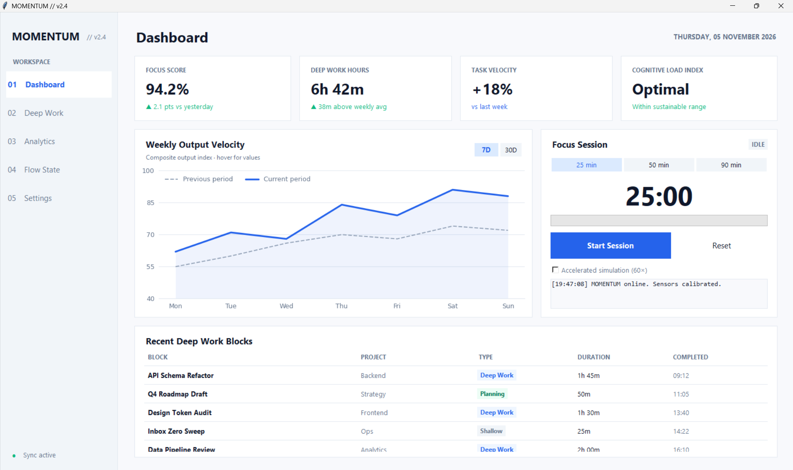
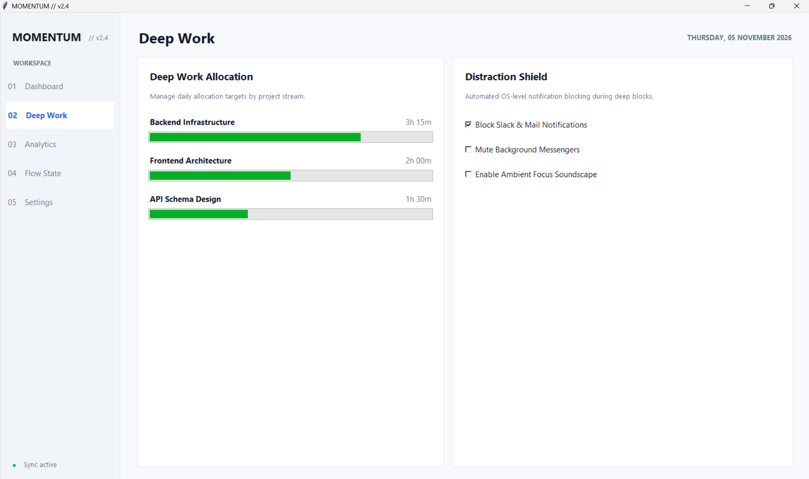
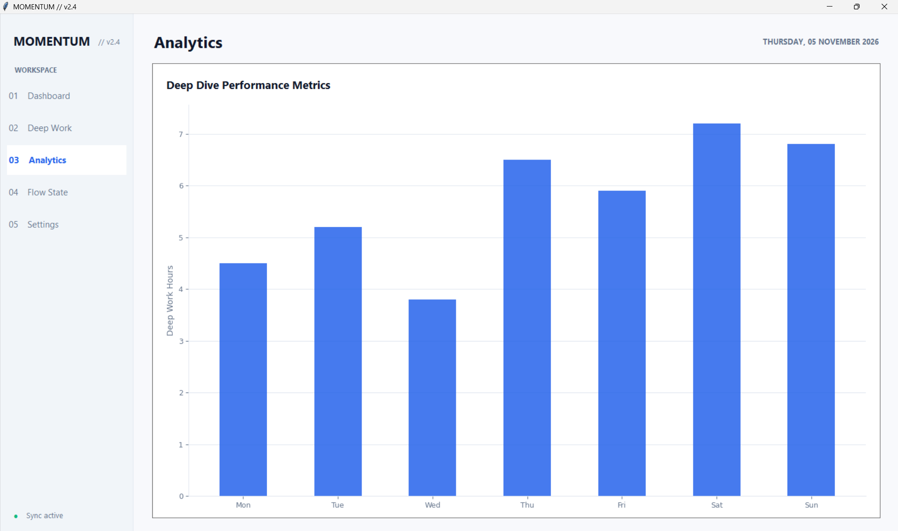
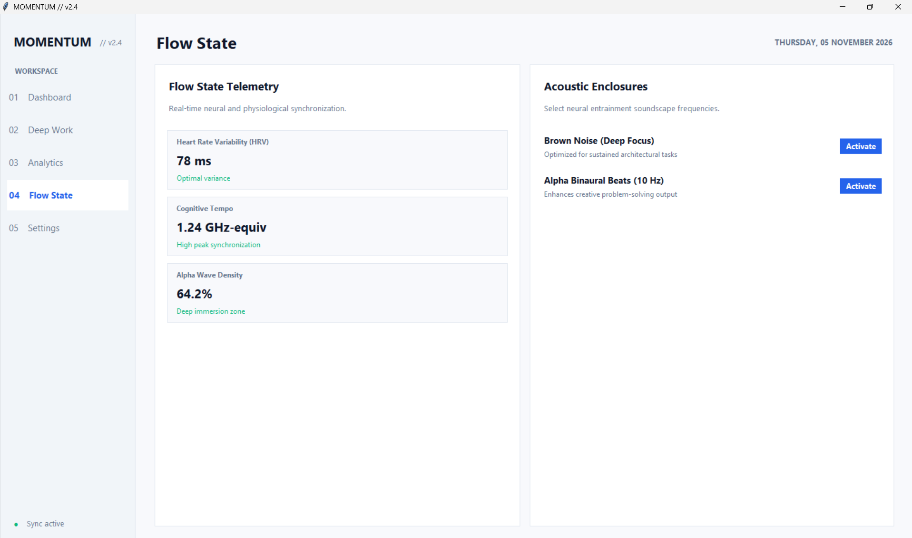
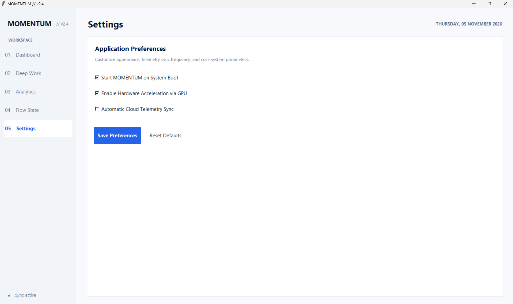

<div align="center">

# ⚡ MOMENTUM // v2.4

### *Lightweight Desktop Productivity Analytics Engine*

[](https://www.python.org/)
[](https://docs.python.org/3/library/tkinter.html)
[](https://matplotlib.org/)
[](LICENSE)

---

<p align="center">
  <b>MOMENTUM</b> is a high-performance desktop productivity analytics dashboard built using standard Python <code>tkinter</code> and <code>Matplotlib</code>. It enables real-time tracking of deep work focus blocks, output velocity, cognitive load indexes, and dynamic workspace biometrics.
</p>

</div>

---

## 📸 Showcase & UI Tour

<div align="center">

### 📊 Main Workspace Dashboard


<br/><br/>

### 📱 Modules Gallery

| 🧠 Focus Session Engine | 📈 Output Velocity & Analytics |
|:---:|:---:|
|  |  |
| **Deep Work Blocks & Soundscapes** | **Hover Data Analytics** |

| 🌊 Flow State Telemetry | ⚙️ Workspace Settings |
|:---:|:---:|
|  |  |
| **Neural Sync Metrics** | **Configurations & Themes** |

</div>

---

## ✨ Core Highlights

- ⏱️ **Focus Timer Engine:** Custom focus blocks (25m, 50m, 90m) equipped with accelerated simulation capability.
- 📊 **Dynamic Velocity Charts:** Integrated Matplotlib graphing engine with hover data telemetry and period filters.
- 🧠 **Biometric Telemetry:** Real-time HRV, cognitive load indexes, and neural synchronization metrics tracking.
- 🎧 **Acoustic Enclosures:** Ambient soundscape audio presets optimized for deep focus blocks.
- 📅 **Dynamic Date Sync:** Adaptive workspace header that auto-syncs with your system time.

---

## 🚀 Quick Start

### Prerequisites

Make sure you have Python 3.10+ installed on your system:
```bash
python --version