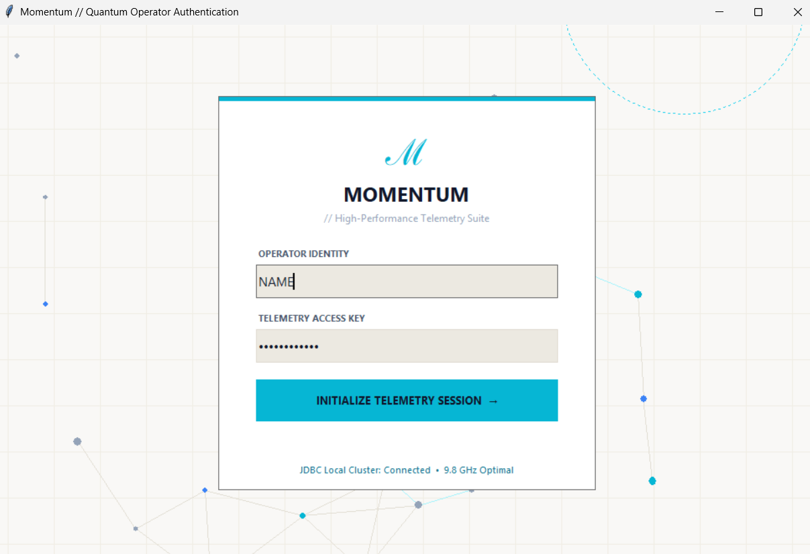
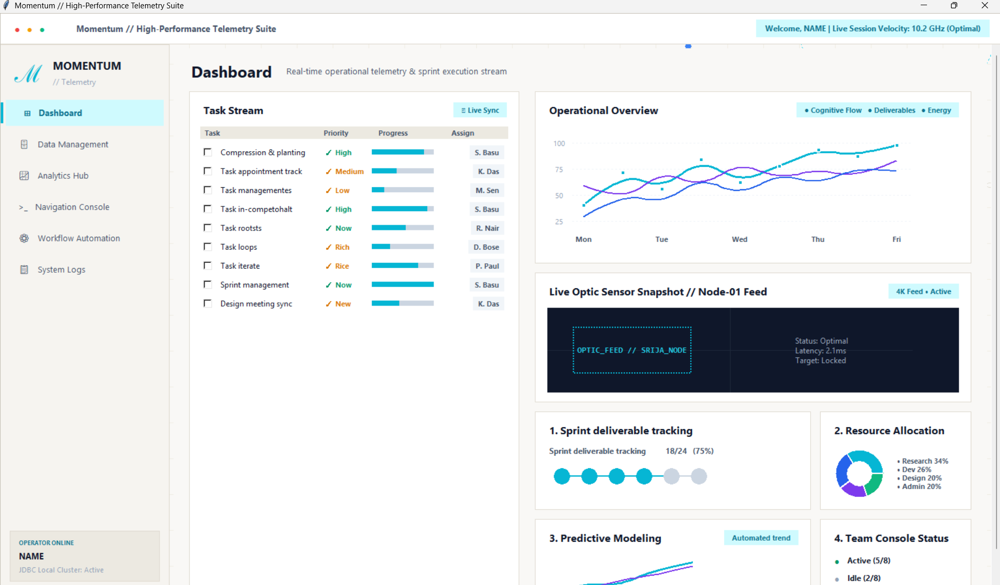
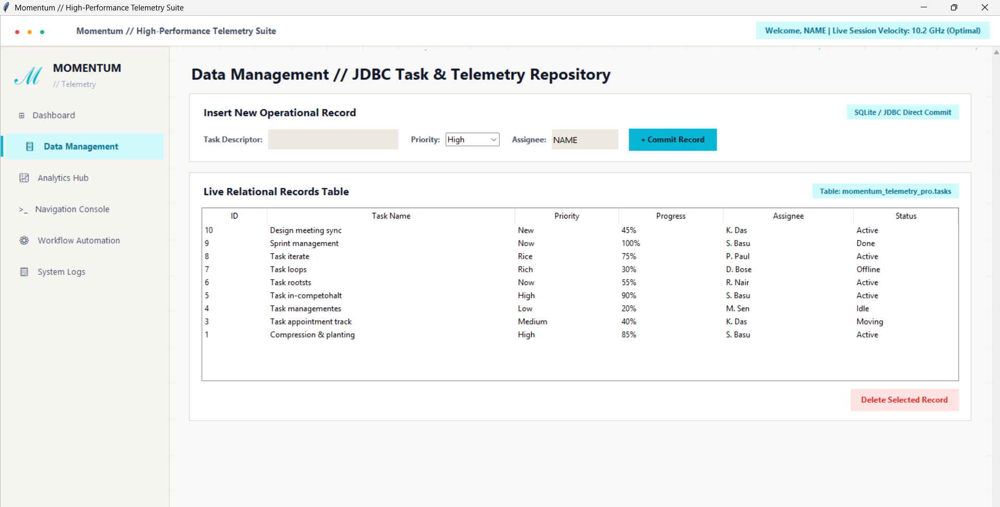
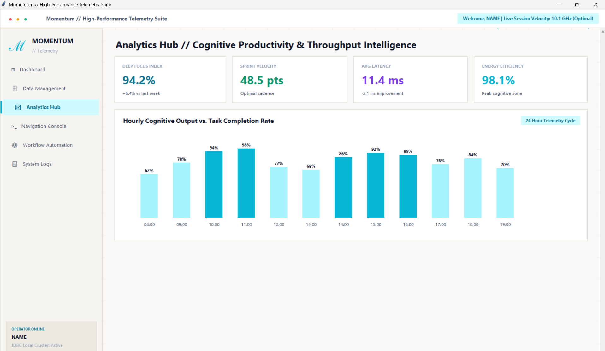
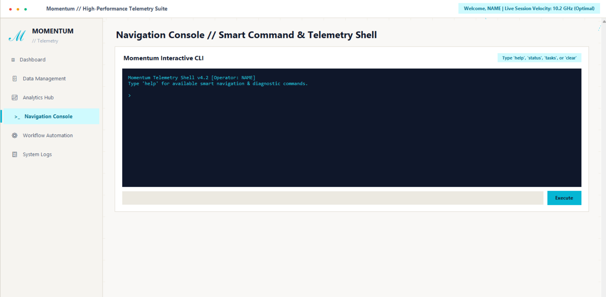
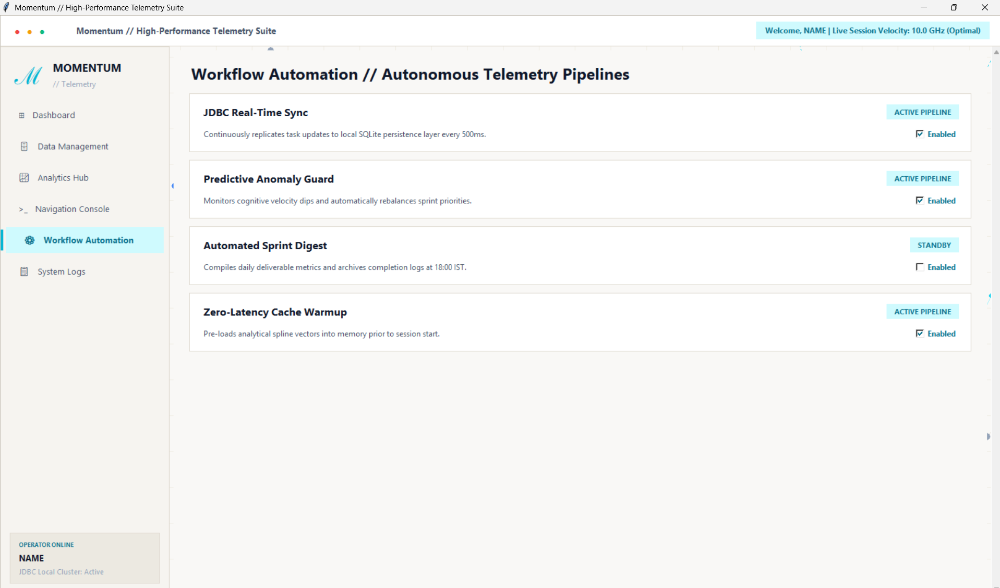
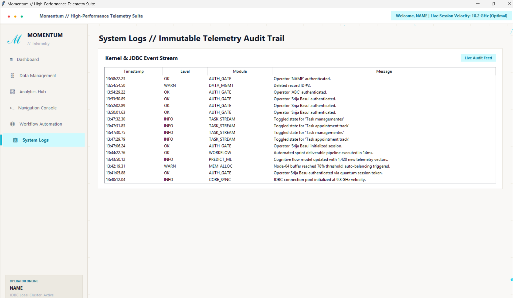

# 🚀 Momentum // High-Performance Telemetry Suite

A high-performance productivity analytics, task stream manager, and telemetry suite built with **Python + Tkinter** and a persistent local **SQLite / JDBC** data layer.

---

## 🌟 Key Features

- **Quantum Operator Authentication**: Frosted-glass login portal with session validation.
- **Live Moving Telemetry Background**: Continuous real-time wireframe grids, particle mesh networks, and radar pulses across every page.
- **Interactive Dashboard**: Task stream with live priority badges, progress bars, multi-spline operational overview charts, resource allocation donut, and team console status.
- **Data Management**: Full relational CRUD interface backed by SQLite/JDBC.
- **Analytics Hub**: Hourly cognitive throughput bar charts and focus KPIs.
- **Navigation Console**: Interactive CLI diagnostics shell.
- **Workflow Automation & System Logs**: Autonomous pipeline toggles and immutable audit trail.

---

## 📸 Screenshots

### 1. Quantum Operator Authentication



### 2. Telemetry Dashboard & Task Stream



### 3. Data Management (JDBC / SQLite Repository)



### 4. Analytics Hub



### 5. Smart Navigation Console



### 6. Workflow Automation



### 7. System Logs & Audit Trail



---

## 🚀 How to Run Locally

1. Open the project folder in **VS Code**.
2. Make sure Python is installed.
3. Open the VS Code terminal.
4. Run the application:

   ```bash
   python momentum.py
   ```

---

## 🛠️ Technologies Used

- Python
- Tkinter
- SQLite
- JDBC (if configured)
- Matplotlib
- Git & GitHub

---

## 📂 Project Structure

```text
PRODUCTIVITY ANALYTICS/
│
├── momentum.py
├── README.md
├── .gitignore
│
├── screenshots/
│   ├── login.png
│   ├── Dashboard.png
│   ├── datamanage.png
│   ├── Analytics.png
│   ├── navigation.png
│   ├── workflow.png
│   └── systemlog.png
│
└── Database files
```

---

## 👨‍💻 Project

**Momentum – High-Performance Telemetry Suite**

A desktop productivity analytics and task management application.